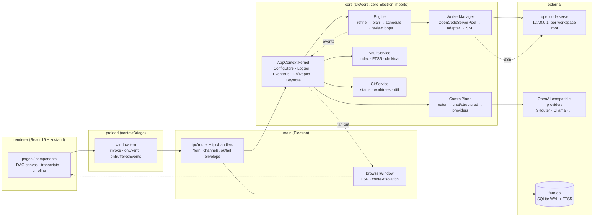

# Architecture — Fern Orchestrator

One Electron main process hosts a UI-agnostic core library (`src/core`) plus the Electron lifecycle (`src/main`); the renderer is a pure projection of backend state fed by a typed event stream. Every claim below is verified against the source tree as of this writing.

## Component overview



Boundaries: the renderer never touches `fs`, `child_process` or network — all privileged work goes through named IPC commands (`src/shared/ipc.ts`). Services communicate through the event bus, not by importing each other's internals.

## Process split: main / preload / renderer

| Layer | Files | Responsibility |
|---|---|---|
| main | `src/main/index.ts`, `src/main/context.ts`, `src/main/ipc/**` | app lifecycle, single-instance lock, window creation, graceful `shutdown()`, IPC handler registration, vault watcher wiring, event fan-out to windows |
| preload | `src/preload/index.ts` | exposes only `window.fern` (`invoke`, `onEvent`, `onBufferedEvents`) via `contextBridge`; converts missing handlers into `{ok:false, code:'not_implemented'}` |
| renderer | `src/renderer/src/**` | React pages, zustand stores (`state/events.ts` buffers up to 800 events), router, toasts; polling only for stats (10s) and health (30s) |
| shared | `src/shared/domain.ts`, `src/shared/ipc.ts` | zod domain types + the `IpcApi` map — single source of truth for both sides of the boundary |
| core | `src/core/**` | everything else; built by `createCoreContext()` with **zero Electron imports** so headless tests run the same object |

Builds: `electron.vite.config.ts` bundles three targets (main, preload, renderer) with aliases `@core`, `@shared`, `@`.

## Kernel context

`createCoreContext({ dataDir })` (`src/core/kernel/appContext.ts`) assembles the `AppContext`:

| Member | Type | Role |
|---|---|---|
| `paths` | `AppPaths` | resolved data paths: `config.json`, `logs/`, `fern.db`, `keystore.bin`, `jobs/`, `opencode-bridge/`, `cache/` (`src/core/platform/paths.ts`) |
| `config` | `ConfigStore` | layered zod config: defaults → `config.json` → env overrides (`FERN_LOG_LEVEL`, `FERN_OPENCODE_BIN`, `FERN_WORKER_CONCURRENCY`); `redacted()` view for diagnostics |
| `logger` | `Logger` | JSONL with channels `app, kernel, db, ipc, orchestration, worker, opencode, provider, git, obsidian, notify`; secret redaction by key name and value pattern |
| `events` | `EventBus` | typed pub/sub with monotonic `seq`, 2000-event replay buffer, per-subscriber isolation |
| `db` / `repos` | `Db` / `Repos` | one better-sqlite3 connection (WAL, `foreign_keys=ON`, `busy_timeout=5000`), migrations, repository layer per aggregate |
| `keystore` | `Keystore` | AES-256-GCM secret store; DB holds only `apiKeyRef` pointers |
| `vaults` | `VaultService` | Obsidian index/FTS/watcher/CRUD |
| `ai` | `ControlPlane` | provider-aware control-plane completions (text + structured), usage, health events |
| `opencode` | `WorkerManager` | server pool + worker session lifecycle |
| `engine` | `Engine` | the run loop (one active run per job, `AbortController` per run) |
| `emit` / `log` / `shutdown` | helpers | `emit` publishes → persists to `events` → raises notifications per config |

`shutdown()` order: engine abort → worker/server teardown → vault dispose → config/keystore/log flush → DB close.

## Database schema

SQLite at `<data dir>/fern.db`; linear append-only migrations in `src/core/db/migrations.ts` (`schema_migrations` table, transactional, snake_case SQL ↔ camelCase TS via repositories).

| Group | Tables |
|---|---|
| Catalog | `projects`, `providers`, `model_routes`, `agent_profiles`, `templates` |
| Jobs | `automation_jobs`, `job_loops`, `tasks`, `workers`, `sessions`, `workflow_nodes`, `workflow_edges` |
| Outcomes | `artifacts`, `reviews`, `approvals`, `usage_records` |
| System | `events`, `notifications`, `git_worktrees` |
| Knowledge | `vaults`, `notes`, `note_links`, `notes_fts` (FTS5, `unicode61 remove_diacritics 2`) |

Key relations: `automation_jobs 1—n job_loops 1—n tasks 1—n workers 1—n sessions` (worker↔session 1:1 via `workers.session_id`, mirror row in `sessions`); `workflow_nodes/edges` are the persisted DAG per `(job, loop_index)`; `artifacts`/`usage_records` carry provenance (`job → loop → task → worker → session → provider/model`); `approvals.opencode_permission_id` links a dashboard decision back to the native permission.

## Control-plane AI

`src/core/services/controlPlane.ts` + `src/core/ai/*` — used for refiner, planner, reviewer/final-reviewer, synthesizer and other non-file work. Workers never go through it.

- **Routing** (`src/core/ai/router.ts`, `resolveModel`): precedence *explicit task/profile override → route preference for the role → automatic (healthiest provider: healthy → degraded → unknown → unreachable) with its default/discovered model*. Builds an ordered **fallback chain** (provider's `fallbackModel`, then up to 3 alternates by health).
- **Retry/fallback policy**: fallbacks are tried only for **retryable** `AppError`s; `provider_auth`, `rate_limited`, `unavailable`, `provider_error` failures emit `provider.failed` (and `provider.fallback` on success). Non-retryable classes (`aborted`, `permission_denied`, `invalid_response`, `provider_auth`) come from `retryPolicySchema` (`src/shared/domain.ts`).
- **Structured output** (`src/core/ai/structured.ts`): `parse → zod-validate → repair → retry` up to `maxAttempts` (default 3); first attempts send `response_format: json_schema`, the last retries plain; JSON extraction is defensive (models may park content in `reasoning_content` — see `docs/adr/0000-phase0-research.md`). Contracts: `job_plan` (`PLAN_JSON_SCHEMA`) and `job_review` (`REVIEW_JSON_SCHEMA`) in `src/core/orchestration/plan.ts`.
- **Usage & health**: every completion records a `usage_records` row (`source: 'control_plane'`); model catalogs are TTL-cached (10 min) per provider.
- **Keys**: fetched from the keystore per request, passed as a header, never logged.

## OpenCode plane

`src/core/opencode/*` — anything that reads/writes files, runs commands or spawns subagents runs here, as a **real OpenCode session**.

- **Server pool** (`serverPool.ts`): detects the binary (`path`/`npm`/`scoop`/manual, `src/core/platform/binaries.ts`), then spawns `opencode serve --port <free> --hostname 127.0.0.1` with `cwd` = workspace root — **one server per workspace directory + a shared "core" server** (`ensureFor`). Each server gets a random `OPENCODE_SERVER_PASSWORD`, injected `OPENCODE_CONFIG_CONTENT` (provider entries with `{env:FERN_OC_KEY_n}` so keys never hit disk), `OPENCODE_PERMISSION` rules (`bash: {'*': 'allow', 'git commit*': <policy>, 'git push*': <policy>, 'git -C * commit/push*': …}`, `edit/task/webfetch: allow`) and a private `OPENCODE_CONFIG_DIR` with generated `agents/*.md` (from agent profiles, `mode: subagent`). Health via `GET /global/health` (45s ready timeout). The pool **only kills processes it started**, keeps a 60-line log tail, and is exposed in the UI through `opencode.*` IPC channels.
- **Adapter** (`adapter.ts`): typed HTTP client for health/version, sessions (create/list/children/abort), prompts, messages/transcripts, diffs, permission replies, agent listing — built against the pinned spec `docs/openapi/opencode-1.18.33.json`.
- **SSE** (`events.ts`): one `/global/event` subscriber per server (`{directory, payload}` wrapper normalized into `NormalizedEvent`), auto-reconnecting loop with capped exponential backoff (≤30s).
- **Worker manager** (`workerManager.ts`): `dispatch(worker)` → ensure server → `createSession` (title = worker name) → `prompt` (async) → stream `message.part.updated` into transcripts and `worker.output` events → `session.idle` settles the worker (`succeeded`), assistant messages yield `usage_records` (`source: 'opencode'`). Per-worker timeout timer aborts the session (`timed_out`); `abort`/`abortJob`/`retry` are explicit transitions; terminal states go through one `settle()` path emitting `worker.failed`/`worker.aborted`.
- **Permission approvals**: `permission.asked` → classify (`git_commit` / `git_push` / `manual_gate`) → create an `approvals` row + set worker `waiting_approval` + emit `approval.requested`. UI decision → `WorkerManager.decidePermission()` → `POST /session/{id}/permissions/{pid}` with `once`/`reject` → worker back to `running`. Plan approval (`requirePlanApproval`) uses the same `approvals` table with `kind: 'plan'` (`jobs.approvePlan`).

## Orchestration engine

`src/core/orchestration/engine.ts` (+ `plan.ts`, `scheduler.ts`, `prompts.ts`). One engine per context, at most one active run per job (`runs: Map<jobId, AbortController>`), scheduler tick 400 ms.

```
start → refine (once) → [loop] plan → compile DAG → [plan-approval gate]
      → executeLoop (dispatch ready tasks within concurrency budget,
                     block on failed deps, retry per policy)
      → integrate (synthesizer → artifact) → review (job_review verdict)
      → verdict fail/needs_more_work && loop < loopCount ? loop++ : finish
```

State enums (all zod, `src/shared/domain.ts`):

- **Job** (`jobStatusSchema`): `draft · refining · planning · ready · running · paused · awaiting_approval · completed · failed · cancelled`
- **Loop** (`loopStatusSchema`): `planning · executing · integrating · reviewing · completed · failed` (verdict: `pending · pass · fail · partial · stop`)
- **Task** (`taskStatusSchema`): `pending · ready · running · waiting_approval · blocked · succeeded · failed · cancelled · skipped · timed_out`
- **Workflow node** (`nodeStateSchema`): same shape as tasks plus `blocked` handling in `NODE_STATE_BY_TASK`; node kinds `task · gate · condition · integration · review · final · research · implementation · validation`
- **Worker** (`workerStatusSchema`): `queued · starting · running · waiting_approval · succeeded · failed · timed_out · aborted · orphaned`
- **Review** verdict: `pending · pass · fail · needs_more_work · stop`; **approval** kinds `git_commit · git_push · plan · manual_gate · vault_write` with statuses `pending · approved · denied · expired · cancelled`

Scheduler rules (`src/core/orchestration/scheduler.ts`): a task is *blocked* when any dependency isn't `succeeded`/`skipped`; *ready* tasks dispatch in priority order within `orchestration.limits.maxConcurrentWorkers` (default 4); failed tasks retry while `attempt < retryPolicy.maxAttempts` and the last worker ended in a retryable state (`failed`, `timed_out`, `orphaned`). DAG compilation rejects duplicate ids, dangling dependencies and cycles (Kahn topological sort) before anything executes. Limits (loops, subagent depth, sessions/job, runtime, token budget) come from `orchestrationLimitsSchema`.

## Event bus

`src/core/kernel/eventBus.ts` — canonical names in `EVENTS`; every publish gets a monotonic `seq` (gap detection / reconnect), lands in the 2000-event replay buffer, is persisted to the `events` table, and is fanned out to renderer windows on `fern:event` (last 500 replayed on `fern:buffer` at load).

| Prefix | Topics |
|---|---|
| `job.*` | `created, started, status, completed, failed, cancelled, plan.ready, plan.approved, finalized` |
| `loop.*` | `started, completed, failed` |
| `task.*` | `created, started, waiting, completed, failed, updated` |
| `worker.*` | `queued, spawned, started, output, completed, failed, aborted, retried` + `subagent.spawned` |
| `artifact.*` / `review.*` | `artifact.created`; `review.started, review.completed` |
| `approval.*` | `requested, resolved` |
| `provider.*` | `connected, failed, health` (+ `provider.fallback` emitted by the control plane) |
| `opencode.*` | `server.started, server.stopped, server.failed, session.lost` |
| `obsidian.*` | `indexed, note.changed, error` |
| other | `project.updated, notification, stats.updated` |

Notifications: `emit` raises a `notifications` row for warn/error events that pass the `notifications` config toggles (`job.failed`, `approval.requested`) plus any `error`-severity event (see the `emit` helper in `src/core/kernel/appContext.ts`).

## IPC layer

- **Contract**: `IpcApi` in `src/shared/ipc.ts` is the single source of truth (channel → args → result). Channels are prefixed `fern:` (`IPC_PREFIX`); main→renderer uses `fern:event` and `fern:buffer`.
- **Router**: `src/main/ipc/router.ts` registers one `ipcMain.handle` per channel; handlers never throw across the boundary — every reply is `{ok:true,data}` or `{ok:false,error,code}` (`AppError.from`).
- **Handlers** (`src/main/ipc/handlers/`): `app` (info, health checks for database/git/opencode/providers/obsidian, onboarding, dialogs, open/reveal), `projects` (CRUD, git status, worktrees, discovery), `providers` (CRUD, test, models, `hasKey` + builtin seeding), `jobs` (list/get/create/update/start/pause/resume/cancel/delete/approvePlan/rerunLoop/finalResult, plus `tasks.*` and `workers.*` and `approvals.*`), `obsidian` (`vaults.*`, `notes.*`, graph), `opencode` (detect, servers start/stop, agents, sessions, transcripts, kill), and app-level `settings.*`, `stats.*`, `timeline.list`, `search.global`, `templates.*`.
- The full channel list (~90 entries across 17 namespaces) is enumerated in `src/shared/ipc.ts`; the renderer accesses it only through the typed `useApi`/`invoke` helpers (`src/renderer/src/lib/api.ts`).

## Security posture

- **Renderer sandboxing**: `contextIsolation: true`, `nodeIntegration: false`, `webSecurity: true` (`src/main/index.ts`); preload exposes a minimal typed bridge — no `fs`/`child_process`/arbitrary net access in the renderer.
- **CSP** (`src/renderer/index.html`): `default-src 'self'; script-src 'self'; style-src 'self' 'unsafe-inline'; img-src 'self' data: file:; font-src 'self' data:; connect-src 'self' ws://localhost:* http://localhost:*`.
- **Window policy**: `setWindowOpenHandler` denies every window; `http(s)` URLs are handed to the OS browser only.
- **API keys**: AES-256-GCM in `keystore.bin` (0600, master key beside the DB); DB stores `apiKeyRef` only; logger redacts sensitive keys (`apiKey/authorization/secret/password/token/credential/…`) and secret-shaped values (`sk-…`, `ghp_…`, `Bearer …`); keys reach OpenCode as `{env:FERN_OC_KEY_n}` references, never in config files.
- **Permission gating**: OpenCode runs with `OPENCODE_PERMISSION` rules where `git commit*`/`git push*` (incl. `git -C * …`) follow the configured `ask` policy — the tool blocks until the dashboard replies `once`/`reject`; reads/edits/builds stay `allow` so there is no per-command nagging. Approvals are rows with status/expiry, decided only through `approvals.decide`.
- **Process hygiene**: OpenCode servers bind `127.0.0.1` with a random basic-auth password; a private `OPENCODE_CONFIG_DIR` per server means the user's global OpenCode config is never read or written; the pool kills only processes it spawned.
- **Repo hygiene**: `.env*`, `*.db*`, `.fern/` are gitignored; no secret material is committed.

## Testing strategy

Runner: Vitest (`vitest.config.ts`) — node environment, `tests/**/*.test.ts`, forks pool, 30s timeouts.

| Suite | Fixture | Covers |
|---|---|---|
| `tests/ai.test.ts` | in-process **mock OpenAI-compatible HTTP server** (modes: ok / garbage / first-call-broken) | `complete()`, `completeJson()` repair loop, `extractJson()` defensive parsing, `resolveModel()` routing |
| `tests/opencode.test.ts` | `tests/fixtures/fake-opencode.mjs` (fake `opencode serve`) | adapter (health/version/sessions/prompt), SSE block parsing + `readEventStream`, config builders (`OPENCODE_PERMISSION`, provider config, agent files), server pool start/stop |
| `tests/worker.test.ts` | fake server + full `createCoreContext` | `WorkerManager` dispatch → idle → completion, permission→approval mapping, transcripts, timeouts (idle emission gated via `FAKE_OC_IDLE`) |
| `tests/context.test.ts` | headless context in a temp data dir | migrations + repositories, job/project/obsidian handlers, approval flows |

Integration tests run against **real** `opencode serve` semantics via the fake server and a temp SQLite/vault — no network, no model cost. `npm run e2e:live` (`scripts/e2e-live.mjs`) is the opt-in live run against the configured provider.

## Known limitations (as of this writing)

- **Approval plugin backstop not generated**: `opencode.enableApprovalPlugin` exists in config, but only native `OPENCODE_PERMISSION` rules are injected today — chained commands (`git add . && git commit`) depend on OpenCode's own pattern matching.
- **Subagent hierarchy is schema-only**: `parentWorkerId` / `parentSessionId` / `depth` and `subagent.spawned` are defined, but child sessions created by OpenCode's `task` tool are not yet registered back into the worker tree.
- **Worker artifacts are thin**: the engine persists the integration artifact and per-worker transcripts (`jobs/<id>/transcripts/*.jsonl`); file/diff rows per worker are not written back to `artifacts` yet (diffs are fetchable via the adapter).
- **Startup reconciliation not implemented**: `orphaned` is a retryable worker state, but nothing marks live-job workers as orphaned after a crash; recovery is limited to per-job resume/rerun.
- **No desktop shell extras yet**: tray, OS notifications and global shortcuts are config-flagged only; notifications are in-app rows.
- **Packaging is default-only**: `dist:win` / `dist:linux` run electron-builder without a custom build config (no signing, no custom icons/installer logic).
- **Retrieval is lexical**: vault search/ranking is FTS5 + metadata; embeddings-based semantic search is a documented extension point, deliberately deferred (no cloud deps).
- **Scenario/E2E coverage partial**: scheduler/loop/controller unit tests and the scripted multi-worker scenario suite from the test plan are not all present yet; current coverage is the four suites above plus the opt-in live run.
